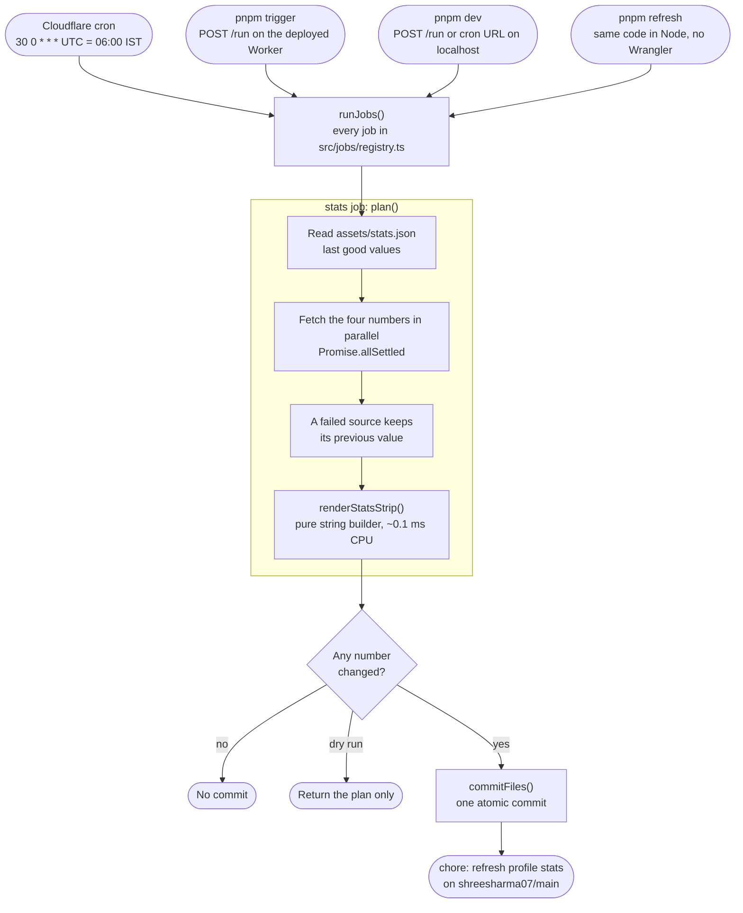
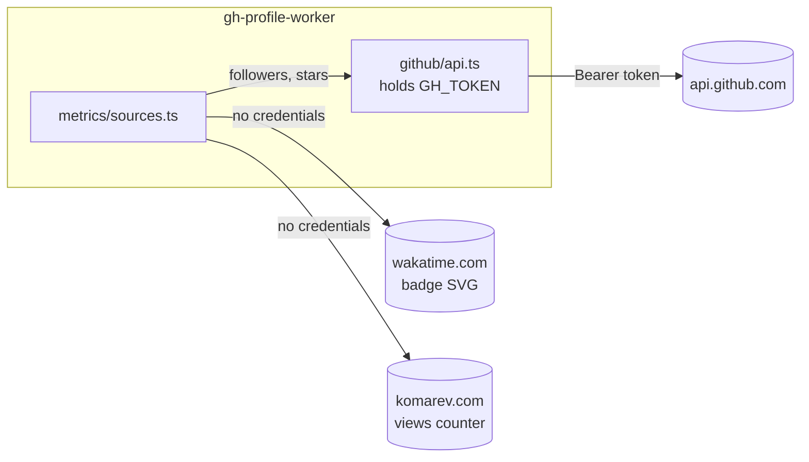
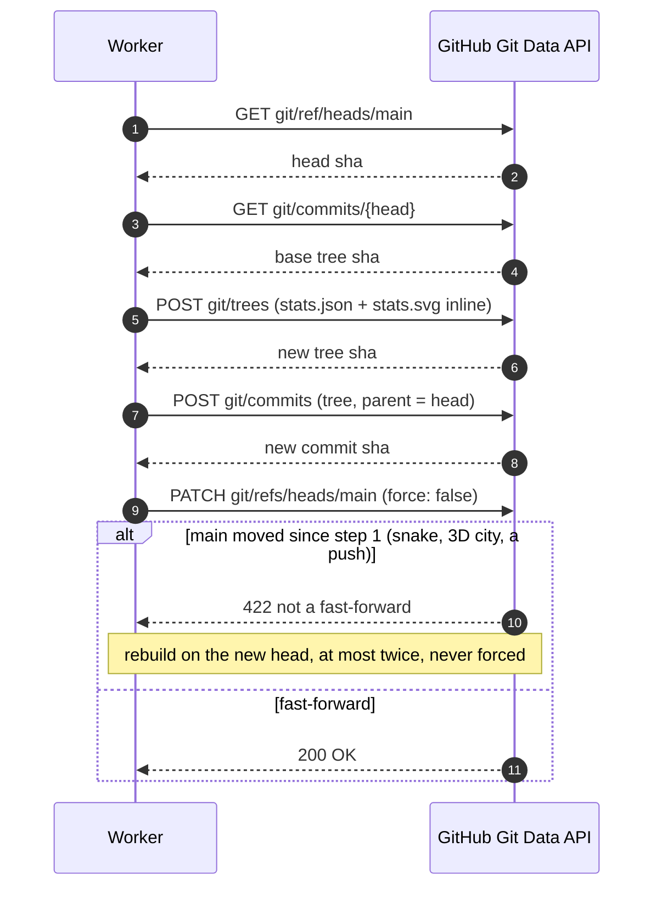
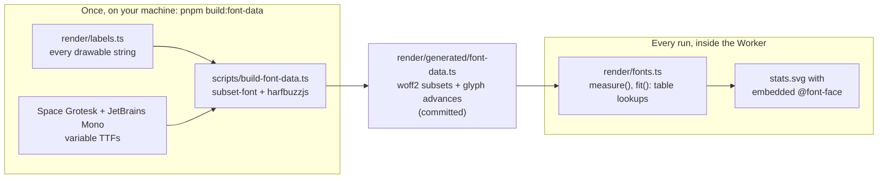
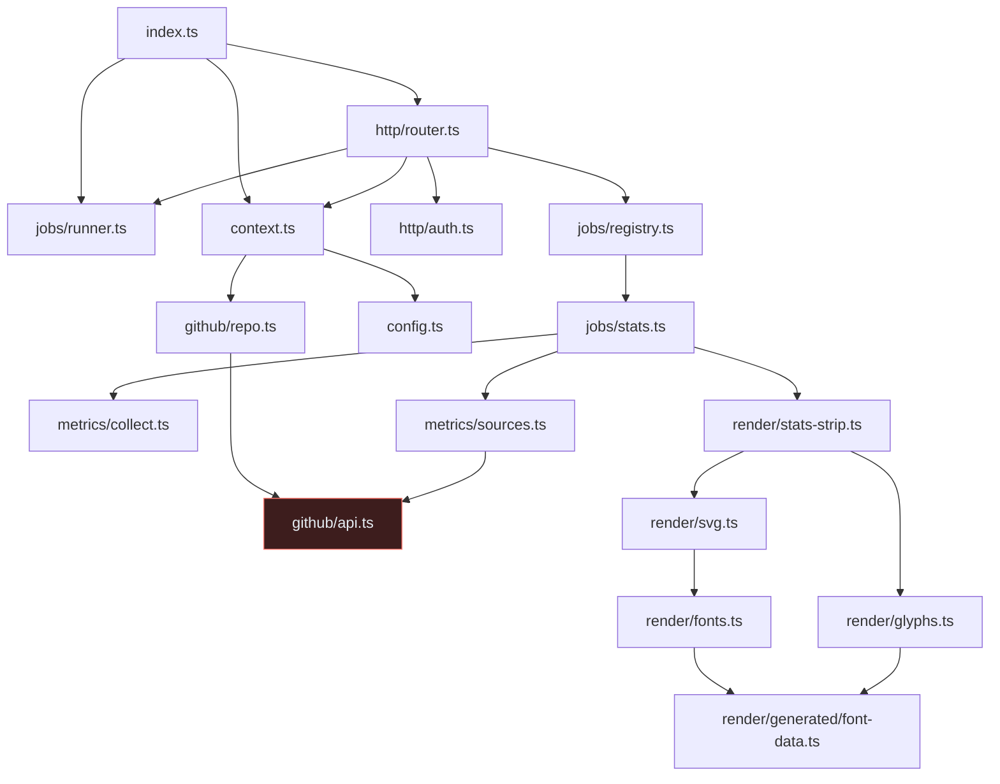
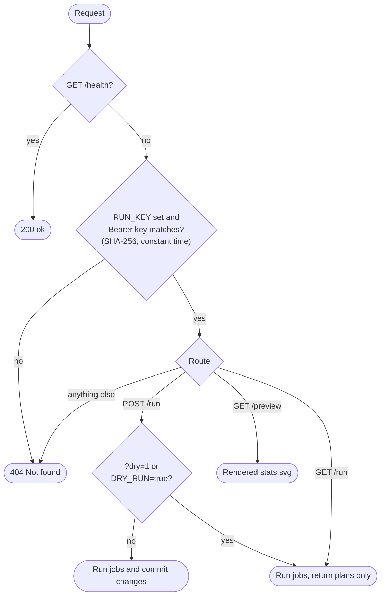

<div align="center">

# gh-profile-worker

**A Cloudflare Worker that keeps the [shreesharma07](https://github.com/shreesharma07/shreesharma07) GitHub profile fresh.**

Once a day it fetches the profile numbers, redraws the stats strip, and commits the result straight into the profile repo through the GitHub API, with no git, no shell, and no Actions minutes.


</div>

## Contents

- [What it does](#what-it-does)
- [How it works](#how-it-works)
- [Project layout](#project-layout)
- [Quick start](#quick-start)
- [Secrets](#secrets)
- [Configuration](#configuration)
- [HTTP routes](#http-routes)
- [Adding a job](#adding-a-job)
- [Development](#development)
- [Deployment](#deployment)
- [Working with the submodule](#working-with-the-submodule)
- [Free plan budget](#free-plan-budget)
- [Troubleshooting](#troubleshooting)
- [Security](#security)

## What it does

The profile README shows a four-tile strip: **profile views**, **all-time coding time**, **followers** and **stars earned**. The Worker:

1. reads the last good values from `assets/stats.json` in the profile repo
2. fetches the four numbers in parallel (GitHub API, WakaTime badge, komarev counter)
3. keeps the previous value for any source that fails, so a flaky endpoint never blanks a tile
4. renders `assets/stats.svg` with the same layout, palette, animations and embedded fonts as every other profile asset
5. commits both files in **one atomic commit**, but only when a number actually changed

It takes over the job of `tools/build-profile.mjs --stats-only` and the `profile-stats.yml` workflow. The snake and 3D contribution graphics stay on GitHub Actions, because their generators need far more CPU than a Worker cron gets.

## How it works

### One run



### Where the numbers come from



The token only ever travels to `api.github.com`. GitHub reads are authenticated because Cloudflare's shared egress IPs exhaust GitHub's anonymous rate limit quickly.

### The atomic commit



### Fonts without HarfBuzz at runtime



The profile's SVGs embed per-file woff2 subsets of Space Grotesk and JetBrains Mono, because GitHub strips web fonts from README HTML. Subsetting needs HarfBuzz (WebAssembly), which is far too slow for a 10 ms CPU budget. So the fonts are subset and measured **once**, and the Worker only does table lookups.

## Project layout

```text
gh-profile-worker/
├── src/
│   ├── index.ts                 entry: scheduled() and fetch() handlers
│   ├── config.ts                Env bindings → typed Config (token kept separate)
│   ├── context.ts               builds the per-run JobContext
│   ├── types.ts                 Metrics, StoredStats, Fetcher
│   ├── github/
│   │   ├── api.ts               REST client; the only holder of GH_TOKEN
│   │   └── repo.ts              readJson() and atomic commitFiles()
│   ├── metrics/
│   │   ├── sources.ts           followers, stars, WakaTime, komarev
│   │   ├── collect.ts           parallel collection with last-good fallback
│   │   └── svg-text.ts          badge text extraction
│   ├── render/
│   │   ├── stats-strip.ts       the four-tile strip
│   │   ├── svg.ts               SvgDoc builder, shared CSS, escaping
│   │   ├── glyphs.ts            eye, people, star, WakaTime icons
│   │   ├── fonts.ts             measure(), fit(), @font-face CSS
│   │   ├── labels.ts            every drawable string (drives the font subset)
│   │   ├── theme.ts             Primer dark palette
│   │   └── generated/
│   │       └── font-data.ts     woff2 subsets + advances (generated, committed)
│   ├── jobs/
│   │   ├── types.ts             Job, JobPlan, JobContext, JobResult
│   │   ├── registry.ts          JOBS: the list the cron runs
│   │   ├── runner.ts            plans every job, commits the changed ones
│   │   └── stats.ts             the stats strip job
│   └── http/
│       ├── router.ts            /health, /run, /preview
│       └── auth.ts              Bearer RUN_KEY, constant-time compare
├── scripts/
│   └── build-font-data.ts       regenerates src/render/generated/font-data.ts
├── test/                        node:test suites with a scripted fake fetch
├── wrangler.toml                name, cron, non-secret vars
├── tsconfig.json                Worker sources (workers-types)
└── tsconfig.node.json           scripts and tests (node types)
```

How the modules depend on each other (arrows point at what a module imports):



`github/api.ts` (highlighted) is the only module that ever sees `GH_TOKEN`.

## Quick start

You need Node.js 22.18 or newer (for native TypeScript), pnpm, and a free Cloudflare account.

```bash
git clone https://github.com/shreesharma07/gh-profile-worker.git
cd gh-profile-worker
pnpm install
cp .env.example .env                  # fill in GH_TOKEN, RUN_KEY and WORKER_URL
pnpm check                            # typecheck + tests + bundle dry run
pnpm refresh:dry                      # fetch and render with live data, no commit
```

### Updating the profile

Every entry point runs the same `runJobs()` and commits straight to `shreesharma07/main` through the GitHub API. Wherever you run it from, the result is a `chore: refresh profile stats` commit on the real repo; there is nothing to push afterwards.

| From                      | Command                             | Needs                                |
| ------------------------- | ----------------------------------- | ------------------------------------ |
| Cloudflare, on schedule   | nothing, daily at 00:30 UTC         | the deployed Worker                  |
| Cloudflare, now           | `pnpm trigger`                      | `WORKER_URL` and `RUN_KEY` in `.env` |
| This machine, no Wrangler | `pnpm refresh`                      | `GH_TOKEN` in `.env`                 |
| This machine, as a Worker | `pnpm dev`, then the requests below | `GH_TOKEN` and `RUN_KEY` in `.env`   |

Add `:dry` (`pnpm refresh:dry`, `pnpm trigger:dry`) to compute and print without committing, or `--job=stats` to run one job. `DRY_RUN=true` in `.env` turns every local path into a dry run.

With `pnpm dev` running (it loads `.env` through `--env-file`), in a second terminal:

```bash
curl http://localhost:8787/health
curl "http://localhost:8787/cdn-cgi/handler/scheduled?cron=30+0+*+*+*"            # the cron handler; commits
curl -X POST -H "Authorization: Bearer $RUN_KEY" http://localhost:8787/run        # commits what changed
curl -X POST -H "Authorization: Bearer $RUN_KEY" "http://localhost:8787/run?dry=1" # never commits
curl -H "Authorization: Bearer $RUN_KEY" -o preview.svg http://localhost:8787/preview
```

After a refresh, run `git pull` in your local clone of the profile repo to pick up the commit.

## Secrets

| Secret     | What it is                                   | How to create                                                                                                                                                                                                                                                             |
| ---------- | -------------------------------------------- | ------------------------------------------------------------------------------------------------------------------------------------------------------------------------------------------------------------------------------------------------------------------------- |
| `GH_TOKEN` | Fine-grained personal access token           | GitHub → Settings → Developer settings → Fine-grained tokens. **Repository access:** only `shreesharma07/shreesharma07`. **Permissions:** Contents → Read and write (Metadata read-only is added automatically). Nothing else. Set an expiry and a reminder to rotate it. |
| `RUN_KEY`  | Random string guarding `/run` and `/preview` | `openssl rand -hex 32`                                                                                                                                                                                                                                                    |

The token does **not** need access to this repository. The Worker only writes to the profile repo, and the public numbers (followers, stars) are readable with any token. Deploying from this repo uses Cloudflare's own GitHub integration, not this token.

Store them for production:

```bash
pnpm wrangler secret put GH_TOKEN
pnpm wrangler secret put RUN_KEY
pnpm secrets                          # lists the names, never the values
```

## Configuration

Plain variables live in `wrangler.toml` under `[vars]`.

| Name                            | Default             | Meaning                                                            |
| ------------------------------- | ------------------- | ------------------------------------------------------------------ |
| `GH_OWNER`                      | `shreesharma07`     | User whose numbers are fetched and who owns the target repo        |
| `GH_REPO`                       | `shreesharma07`     | Repo the files are committed to                                    |
| `GH_BRANCH`                     | `main`              | Branch to commit to                                                |
| `STATS_JSON_PATH`               | `assets/stats.json` | Stored values (`followers`, `stars`, `coding`, `views`, `updated`) |
| `STATS_SVG_PATH`                | `assets/stats.svg`  | Rendered strip                                                     |
| `WAKATIME_USER_ID`              | profile's id        | Public WakaTime badge id; empty skips the coding tile's refresh    |
| `COMMIT_AUTHOR_NAME` / `_EMAIL` | `gh-profile-worker` | Author of the refresh commits                                      |
| `DRY_RUN`                       | `false`             | `true` disables every commit                                       |

To change the schedule, edit `crons` in `wrangler.toml` and deploy. Cron expressions are UTC.

## HTTP routes

| Route                 | Auth             | Result                                             |
| --------------------- | ---------------- | -------------------------------------------------- |
| `GET /health`         | none             | `{"ok":true}`                                      |
| `POST /run`           | Bearer `RUN_KEY` | Runs every job; commits what changed; JSON results |
| `POST /run?dry=1`     | Bearer `RUN_KEY` | Same, never commits                                |
| `POST /run?job=stats` | Bearer `RUN_KEY` | Runs one job                                       |
| `GET /run`            | Bearer `RUN_KEY` | Always a dry run; GET never writes                 |
| `GET /preview`        | Bearer `RUN_KEY` | Freshly rendered `stats.svg`, never commits        |

The key is accepted **only** in the `Authorization` header, never in the URL. A missing key, a wrong key and an unknown path all return the same `404`. If `RUN_KEY` is unset, the manual routes are disabled.



```bash
export WORKER_URL="https://gh-profile-worker.<your-subdomain>.workers.dev"
curl -X POST -H "Authorization: Bearer $RUN_KEY" "$WORKER_URL/run?dry=1"   # check the values
curl -X POST -H "Authorization: Bearer $RUN_KEY" "$WORKER_URL/run"         # commit if changed
```

## Adding a job

Jobs are the extension point for anything else the profile should refresh.

1. Create `src/jobs/<name>.ts` exporting a `Job`:

   ```ts
   import type { Job } from './types.ts';

   export const myJob: Job = {
     name: 'my-job',
     async plan(ctx) {
       const previous = await ctx.repo.readJson<{ value: number }>('assets/my.json');
       const value = 42;
       return {
         files: { 'assets/my.json': `${JSON.stringify({ value }, null, 2)}\n` },
         changed: previous?.value !== value,
         message: 'chore: refresh my thing',
         details: { value },
       };
     },
   };
   ```

2. Add it to `JOBS` in `src/jobs/registry.ts`.
3. Add a test in `test/`, then `pnpm check`.

A job never commits by itself. The runner commits each changed plan separately, so the profile's history stays readable, and one failing job never blocks the others. Use `ctx.fetcher` for third-party endpoints and `ctx.api` for GitHub; never pass the token anywhere else.

If a new SVG draws new text, add the strings to `src/render/labels.ts` and run `pnpm build:font-data`.

## Development

| Command                        | What it does                                                                              |
| ------------------------------ | ----------------------------------------------------------------------------------------- |
| `pnpm dev`                     | Local Worker with the cron test route, secrets from `.env`; commits unless `DRY_RUN=true` |
| `pnpm refresh` / `refresh:dry` | Runs every job in Node and commits to the profile repo / only prints                      |
| `pnpm trigger` / `trigger:dry` | `POST /run` on the deployed Worker / with `?dry=1`                                        |
| `pnpm lint`                    | Biome lint, format and import-order check (read-only)                                     |
| `pnpm lint:fix`                | Applies Biome's safe fixes and formatting                                                 |
| `pnpm format`                  | Formats only, no lint fixes                                                               |
| `pnpm typecheck`               | `tsc` over the Worker and the Node configs                                                |
| `pnpm test`                    | All `test/**/*.test.ts` with `node --test`                                                |
| `pnpm check`                   | `biome ci`, typecheck, tests and a bundle dry run; run before every push                  |
| `pnpm build:font-data`         | Regenerates the font subsets after `labels.ts` changes                                    |
| `pnpm deploy:dry`              | Bundles into `dist/` without deploying                                                    |
| `pnpm tail`                    | Streams live logs, including each cron result                                             |
| `pnpm whoami`                  | Shows the Cloudflare account Wrangler deploys to                                          |

TypeScript runs in strict mode with `noUncheckedIndexedAccess`, `exactOptionalPropertyTypes` and `erasableSyntaxOnly`. The last one keeps every file runnable by Node's built-in type stripping, so tests and scripts need no build step.

[Biome](https://biomejs.dev) is the single tool for formatting and linting (`biome.json`). It uses 2-space indentation, single quotes, semicolons, trailing commas and a 120-column width. The recommended rules are on, plus `useImportType` and `useNodejsImportProtocol`, and imports are kept sorted. Generated files under `src/render/generated/` are skipped. In VS Code, the recommended Biome extension formats and fixes on save (`.vscode/settings.json`).

## Deployment

```bash
pnpm wrangler login       # once, opens the browser
pnpm check
pnpm deploy
```

The output prints the Worker URL and confirms the `30 0 * * *` trigger. Run it once by hand (`POST /run`) and look for a `chore: refresh profile stats` commit by `gh-profile-worker` in the profile repo.

**Deploy on push, without Actions.** In the Cloudflare dashboard, open Workers & Pages → `gh-profile-worker` → Settings → Builds → Connect, then choose this repo and branch `main`. Set the build command to `pnpm check` and the deploy command to `pnpm wrangler deploy`. Secrets set with `wrangler secret put` survive these deploys.

| Wrangler command                     | What it does                         |
| ------------------------------------ | ------------------------------------ |
| `pnpm wrangler deployments list`     | Deployment history                   |
| `pnpm wrangler rollback`             | Roll back to the previous deployment |
| `pnpm wrangler secret delete <NAME>` | Remove a secret                      |

## Working with the submodule

The profile repo mounts this repo at `workers/gh-profile-worker`.

| Task                      | Command (from the profile repo)                                                                                        |
| ------------------------- | ---------------------------------------------------------------------------------------------------------------------- |
| Clone everything          | `git clone --recurse-submodules https://github.com/shreesharma07/shreesharma07.git`                                    |
| Fetch after a plain clone | `git submodule update --init --recursive`                                                                              |
| Follow the latest `main`  | `git submodule update --remote --merge workers/gh-profile-worker`, then commit the pointer                             |
| Edit in place             | `cd workers/gh-profile-worker && git switch main`, edit, commit, push, then commit the new pointer in the profile repo |
| Show the pinned commit    | `git submodule status`                                                                                                 |

A submodule starts on a detached HEAD, so run `git switch main` before you edit.

## Free plan budget

| Limit (free plan)           | A typical run                                                                    |
| --------------------------- | -------------------------------------------------------------------------------- |
| 10 ms CPU per invocation    | a few ms at most (the render itself is about 0.1 ms; network waits do not count) |
| 50 subrequests              | about 10 (1 read, 4 sources, 5 to commit)                                        |
| 5 cron triggers per account | 1                                                                                |
| 3 MB bundle                 | about 30 KiB                                                                     |

## Troubleshooting

| Symptom                           | Fix                                                                                          |
| --------------------------------- | -------------------------------------------------------------------------------------------- |
| `GH_TOKEN secret is not set`      | Fill `.env` locally, or `pnpm wrangler secret put GH_TOKEN`                                  |
| `HTTP 401` from GitHub            | The token expired or was mistyped; create a new one and set it again                         |
| `HTTP 403` / `404` on `/git/…`    | The token lacks Contents write access or does not include the profile repo                   |
| `HTTP 422` after retries          | `main` is protected and requires pull requests; allow this token or relax the rule           |
| A tile shows `·`                  | That number has never been fetched; check `failures` in `POST /run?dry=1`                    |
| `/run` returns 404                | Missing or wrong `Authorization: Bearer` header, or `RUN_KEY` is not set                     |
| New text renders in a system font | The characters are not in the subset; add them to `labels.ts` and run `pnpm build:font-data` |
| No cron runs                      | Dashboard → Settings → Triggers, then `pnpm tail` at 00:30 UTC                               |

## Security

See [SECURITY.md](SECURITY.md) for the threat model and how to report a vulnerability.

## License

[MIT](LICENSE) © Shree Kumar Sharma
