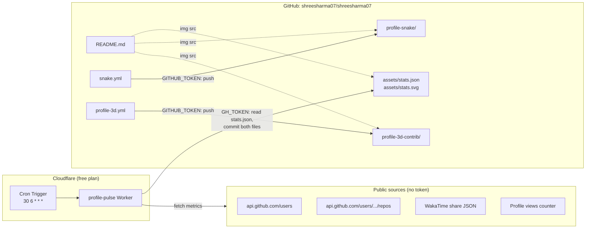
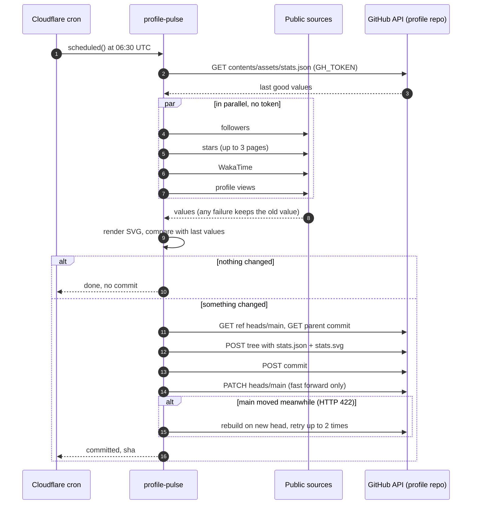
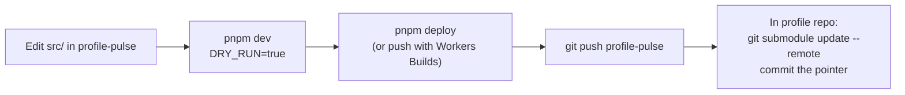

# shreesharma07 profile automation

How the GitHub profile at [github.com/shreesharma07](https://github.com/shreesharma07) keeps itself up to date: what runs, where it runs, when it runs, what it is allowed to touch, and how to look after it.

## Contents

1. Overview
2. Repositories and roles
3. Architecture
4. Schedule
5. Job 1: stats strip (profile-pulse on Cloudflare)
6. Job 2: contribution snake (GitHub Actions)
7. Job 3: 3D contribution city (GitHub Actions)
8. How the three writers share one branch
9. Credentials and permissions
10. Access matrix by folder
11. Creating the fine-grained token
12. Deploying and changing profile-pulse
13. Failure handling
14. Monitoring
15. Maintenance calendar
16. Limits
17. Troubleshooting
18. File map

## 1. Overview

The profile README shows three generated images: a stats strip (followers, stars, coding time, profile views), a contribution snake, and a 3D contribution city. Each image is an SVG committed into the profile repo, and the README simply links to those files. Three independent jobs regenerate them on a schedule and commit the result to `main`.

The stats strip is produced by **profile-pulse**, a Cloudflare Worker that runs on Cloudflare's free plan and commits through the GitHub API. The snake and the 3D city are produced by **GitHub Actions** workflows inside the profile repo, because their generators need more CPU than the free Worker allows. Nothing needs to be run by hand.

## 2. Repositories and roles

| Repository | Visibility | Role |
| --- | --- | --- |
| `shreesharma07/shreesharma07` | public | The profile repo. Holds the README, the generated SVGs, the two Actions workflows, and profile-pulse as a submodule. |
| `shreesharma07/profile-pulse` | public | Source code of the Cloudflare Worker. Deployed to Cloudflare from here. |

profile-pulse is mounted inside the profile repo at `workers/profile-pulse` as a git submodule. The submodule exists so the whole portfolio is reachable from one repo; it has no role at runtime. Cloudflare never reads it, and nothing in the profile repo executes it.

## 3. Architecture



There are two independent automation engines writing into one repo. Cloudflare handles the lightweight stats job; GitHub Actions handles the two heavy renders. They share nothing except the `main` branch, and each writes to its own folder.

## 4. Schedule

All cron expressions run in UTC. IST is UTC + 5:30.

| Job | Engine | Cron | UTC | IST | Frequency |
| --- | --- | --- | --- | --- | --- |
| Stats strip | Cloudflare Worker | `30 6 * * *` | 06:30 | 12:00 | daily |
| Contribution snake | GitHub Actions | `0 */12 * * *` | 00:00, 12:00 | 05:30, 17:30 | twice daily |
| 3D contribution city | GitHub Actions | `0 18 * * *` | 18:00 | 23:30 | daily |

The schedules are deliberately spread out, so the jobs rarely run at the same moment. GitHub Actions schedules can start several minutes late under load; the Cloudflare cron is usually on time.

## 5. Job 1: stats strip (profile-pulse on Cloudflare)

### What it automates

Fetching the current follower count, total stars across your own non-fork repos, WakaTime coding time and profile views; redrawing the stats SVG; and committing the SVG and its data file to the profile repo, but only when a number actually changed.

### How a run works



The Worker never runs git or a shell. Both files land in a single commit, built from a tree and moved onto `main` as a fast forward, so the repo is never left with one file updated and the other stale.

### Code layout

| File | Responsibility | Holds the token? |
| --- | --- | --- |
| `src/index.js` | Cron handler and HTTP routes; orchestrates a run | no |
| `src/metrics.js` | Public metric fetchers with last good value fallback | no |
| `src/render.js` | Builds the SVG string | no |
| `src/github.js` | Reads `stats.json` and makes the atomic commit; enforces the path allowlist | **yes** |

### HTTP routes

| Route | Auth | Result |
| --- | --- | --- |
| `GET /health` | none | `{"ok":true}` |
| `GET /run?key=…` | `RUN_KEY` | Full run; commits if changed; returns JSON |
| `GET /run?key=…&dry=1` | `RUN_KEY` | Full run without committing |
| `GET /preview?key=…` | `RUN_KEY` | Returns the freshly rendered SVG, no commit |

Any other path, or a wrong or missing key, returns 404. `/run` is the replacement for the old `workflow_dispatch` button.

### Configuration

| Name | Kind | Value | Meaning |
| --- | --- | --- | --- |
| `GH_OWNER` | var | `shreesharma07` | Whose metrics are fetched; owner of the target repo |
| `GH_REPO` | var | `shreesharma07` | Repo the files are committed to |
| `GH_BRANCH` | var | `main` | Branch to commit to |
| `STATS_JSON_PATH` | var | `assets/stats.json` | Stored values |
| `STATS_SVG_PATH` | var | `assets/stats.svg` | Rendered strip |
| `WAKATIME_JSON_URL` | var | your share URL | Empty keeps the last value |
| `DRY_RUN` | var | `false` | `true` blocks all commits |
| `GH_TOKEN` | secret | fine-grained PAT | See section 11 |
| `RUN_KEY` | secret | random string | Guards `/run` and `/preview` |

Vars live in `wrangler.toml`. Secrets are stored in Cloudflare with `pnpm wrangler secret put` and never appear in either repo.

## 6. Job 2: contribution snake (GitHub Actions)

`.github/workflows/snake.yml` stays in the profile repo and runs unchanged.

GitHub starts it every 12 hours (or on demand from the Actions tab via `workflow_dispatch`). It checks out the repo, runs `Platane/snk/svg-only@v3`, which reads your public contribution calendar and solves the snake's path, writes `profile-snake/snake-dark.svg`, and pushes the result if the file changed. It authenticates with the automatic `GITHUB_TOKEN` that GitHub creates for every workflow run and revokes when the run ends; `permissions: contents: write` in the file is what allows the push. It does not use the profile-pulse token.

It stays on Actions because the path solver is real computation, far beyond the 10 ms of CPU a free Worker gets.

## 7. Job 3: 3D contribution city (GitHub Actions)

`.github/workflows/profile-3d.yml` also stays and runs unchanged.

GitHub starts it daily at 18:00 UTC. It runs `yoshi389111/github-profile-3d-contrib@v0.9.3` with your colour settings from `.github/profile-3d-settings.json`, deletes every output except `profile-city.svg`, and pushes `profile-3d-contrib/` if anything changed. Like the snake, it uses the automatic `GITHUB_TOKEN`, here also passed to the action so it can query your contribution data.

It stays on Actions for the same reason: building the 3D scene is too heavy for the free Worker.

## 8. How the three writers share one branch

Three jobs commit to `main`. They stay out of each other's way in three ways.

They write to **separate folders**: `assets/` for the Worker, `profile-snake/` for the snake, `profile-3d-contrib/` for the city. Two jobs never edit the same file, so there are no content conflicts.

The **Actions jobs rebase before pushing** (`git pull --rebase` then `git push`), so a Worker commit that landed while they were rendering is simply replayed underneath theirs.

The **Worker only fast forwards** `main`. If an Actions job pushed between the Worker reading `main` and updating it, GitHub answers HTTP 422; the Worker rebuilds its commit on the new head and tries again, up to two more times.

Your own pushes to the profile repo follow the same rule: run `git pull --rebase` before pushing, since `main` receives automated commits several times a day.

## 9. Credentials and permissions

| Credential | Used by | Where it lives | Scope | Lifetime |
| --- | --- | --- | --- | --- |
| `GH_TOKEN` (fine-grained PAT) | profile-pulse Worker | Cloudflare secret; `.dev.vars` locally (git-ignored) | `shreesharma07/shreesharma07` only; Contents read and write; Metadata read | up to a year, then rotate |
| `GITHUB_TOKEN` (automatic) | `snake.yml`, `profile-3d.yml` | created by GitHub per run | the profile repo; `contents: write` as declared in each workflow | one workflow run |
| `RUN_KEY` | you, when calling `/run` or `/preview` | Cloudflare secret; `.dev.vars` locally | only unlocks the Worker's two manual routes | until you rotate it |
| Cloudflare login | you, for `wrangler deploy` | your machine (`wrangler login`) | your Cloudflare account | until `wrangler logout` |

Within the Worker, only `src/github.js` reads `GH_TOKEN`. The metric fetchers call public endpoints with no credentials, so a compromised data source can never see the token.

## 10. Access matrix by folder

GitHub tokens are scoped per repository, not per folder. The folder boundary for the Worker is enforced in code: `src/github.js` refuses to write any path outside `assets/` (or containing `..`) before it makes a single API call.

| Path in `shreesharma07` | profile-pulse (`GH_TOKEN`) | `snake.yml` | `profile-3d.yml` | You |
| --- | --- | --- | --- | --- |
| `assets/stats.json` | read, write | | | read |
| `assets/stats.svg` | write | | | read |
| `assets/` (anything else) | allowed by code, but never written | | | read, write |
| `profile-snake/` | blocked by allowlist | write | | read |
| `profile-3d-contrib/` | blocked by allowlist | | write, delete | read |
| `.github/workflows/` | blocked by allowlist and by missing Workflows permission | | | read, write |
| `.github/profile-3d-settings.json` | blocked by allowlist | | read | read, write |
| `workers/profile-pulse` (submodule pointer) | blocked by allowlist | | | update when bumping |
| `README.md` and everything else | blocked by allowlist | | | read, write |

Blank cells mean the job neither reads nor writes that path. The real security boundary is the combination of a single-repo token with Contents only, no Workflows permission, and the code allowlist.

## 11. Creating the fine-grained token

The token targets **`shreesharma07/shreesharma07`**, the repo the Worker writes into. It needs no access to `profile-pulse`.

1. On GitHub open your avatar → **Settings** → **Developer settings** → **Personal access tokens** → **Fine-grained tokens** → **Generate new token**.
2. Fill in the form:

   | Field | Value |
   | --- | --- |
   | Token name | `profile-pulse` |
   | Description | Cloudflare Worker commits stats to profile repo |
   | Resource owner | `shreesharma07` |
   | Expiration | custom date about one year out |
   | Repository access | **Only select repositories** → `shreesharma07/shreesharma07` |
   | Repository permissions → Contents | **Read and write** |
   | Repository permissions → Metadata | Read-only (added automatically, required) |
   | All other repository permissions | No access |
   | Account permissions | No access |

3. **Generate token** and copy it immediately; GitHub shows it once.
4. Store it in Cloudflare and locally:

   ```bash
   cd ~/code/profile-pulse
   pnpm wrangler secret put GH_TOKEN
   # and paste it into .dev.vars as GH_TOKEN=...
   ```

5. Put a calendar reminder one week before the expiry date.

Never grant Workflows, Actions, Administration or Secrets. Without Workflows permission, a leaked token cannot change `.github/workflows/`, which is the usual way a stolen token gets turned into something worse.

## 12. Deploying and changing profile-pulse



Deploying is what changes the running Worker; the submodule pointer only records which version of the source the profile repo shows. The usual cycle:

```bash
cd ~/code/profile-pulse
git pull
pnpm dev                                    # local test, never commits
pnpm deploy                                 # live on Cloudflare
git add . && git commit -m "feat: ..." && git push

cd ~/code/shreesharma07
git pull --rebase
git submodule update --remote --merge workers/profile-pulse
git add workers/profile-pulse
git commit -m "chore: bump profile-pulse"
git push
```

If Cloudflare Workers Builds is connected to `shreesharma07/profile-pulse` (deploy command `pnpm wrangler deploy`), pushing to `main` deploys automatically and `pnpm deploy` is unnecessary. Secrets survive every deploy.

To change when the stats refresh, edit `crons` in `wrangler.toml` and deploy. To change the snake or city schedule, edit the `cron` line in its workflow file in the profile repo and push.

## 13. Failure handling

| Failure | What happens |
| --- | --- |
| One metric source is down or rate limited | That metric keeps its last good value from `stats.json`; the others update; the run still commits if anything changed. The failure is listed under `failures` in the run result and in the logs. |
| All sources fail | Every value equals the stored one, so nothing is committed. |
| `stats.json` missing (first run) | The Worker starts from empty values and creates both files. |
| `main` moved during the commit | HTTP 422 on the ref update; the commit is rebuilt on the new head, up to two retries. |
| Token expired or revoked | GitHub returns 401; the run fails and nothing is written. Rotate the token (section 15). |
| A write outside `assets/` is attempted | `github.js` throws before any API call; nothing is written. |
| Worker exceeds CPU or subrequest limits | The run is killed by Cloudflare and nothing is written; it appears as an error in the dashboard. |
| An Actions job fails | GitHub emails you and marks the run red in the Actions tab; the previous SVG stays in place. |

In every failure case the profile keeps showing the last successfully committed images, so the README never breaks.

## 14. Monitoring

| What to check | How |
| --- | --- |
| Live Worker logs, including each cron result | `pnpm tail` in `profile-pulse` |
| Past Worker runs and errors | Cloudflare dashboard → Workers & Pages → `profile-pulse` → Observability / Metrics |
| Cron is registered | Dashboard → `profile-pulse` → Settings → Triggers shows `30 6 * * *` |
| Current values without committing | `curl "$PULSE_URL/run?key=$RUN_KEY&dry=1"` |
| What the strip looks like right now | open `$PULSE_URL/preview?key=$RUN_KEY` |
| Snake and city runs | Profile repo → Actions tab |
| Everything actually landed | Profile repo commit history: `chore: refresh profile stats`, `chore: refresh contribution snake`, `chore: refresh 3D contribution calendar` |

A healthy week shows up to 7 stats commits, up to 14 snake commits and up to 7 city commits. Fewer is normal on days when nothing changed.

## 15. Maintenance calendar

| When | Task | Command or place |
| --- | --- | --- |
| Before the PAT expires (yearly) | Create a new token with the same settings, store it, delete the old one | `pnpm wrangler secret put GH_TOKEN`, update `.dev.vars`, then GitHub → Fine-grained tokens → delete old |
| If `RUN_KEY` is ever shared | Rotate it | `openssl rand -hex 24`, then `pnpm wrangler secret put RUN_KEY` |
| Occasionally | Update Wrangler | `pnpm update wrangler`, test, deploy |
| Occasionally | Update the Actions' versions (`actions/checkout`, `Platane/snk`, `github-profile-3d-contrib`) | edit the workflow files in the profile repo |
| After changing profile-pulse | Bump the submodule pointer | section 12 |
| Public profile repo with no activity for 60 days | GitHub disables scheduled workflows; re-enable from the Actions tab | the Worker's daily commits normally count as activity, so this rarely happens |

## 16. Limits

| Limit | Value | profile-pulse usage |
| --- | --- | --- |
| Cloudflare CPU per cron run (free) | 10 ms (network waits excluded) | about 1 ms |
| Cloudflare subrequests per run (free) | 50 | about 9 |
| Cloudflare cron triggers per account (free) | 5 | 1 |
| Cloudflare requests per day (free) | 100,000 | 1 cron plus any manual calls |
| GitHub unauthenticated API rate limit | 60 per hour per IP | about 4 per run, shared with other Cloudflare traffic on the same IP, hence the last good value fallback |
| GitHub authenticated API rate limit (PAT) | 5,000 per hour | about 5 per run |
| GitHub Actions minutes (public repo) | unlimited | snake and city |
| Profile-pulse files committed per run | 2 (allowlisted to `assets/`) | 2 |

## 17. Troubleshooting

| Symptom | Likely cause | Fix |
| --- | --- | --- |
| No stats commit for several days | Nothing changed, or the Worker is failing | `pnpm tail` at 06:30 UTC, or `/run?…&dry=1` to see values and `failures` |
| `GitHub … HTTP 401` | Token expired or mistyped | Rotate `GH_TOKEN` |
| `GitHub … HTTP 403` or `404` on `/git/…` | Token lacks Contents write or doesn't include the profile repo | Recreate the token per section 11 |
| `HTTP 422` after retries | `main` protected by a rule that requires pull requests | Allow this token to bypass, or relax the rule |
| `Refusing to write outside assets/` | `STATS_JSON_PATH` or `STATS_SVG_PATH` points outside `assets/` | Fix the paths in `wrangler.toml` and deploy |
| A metric shows `n/a` | It has never fetched successfully | Check `failures`; fix the source in `src/metrics.js` |
| Image on the profile looks old | GitHub's image proxy cache | Check the commit history; the image catches up on its own |
| Snake or city stopped updating | Action failed or scheduled workflows were disabled | Profile repo → Actions tab → re-run or re-enable |
| Your push to the profile repo is rejected | An automated commit landed first | `git pull --rebase`, then push |
| Submodule folder empty after cloning | Submodules not initialised | `git submodule update --init --recursive` |

## 18. File map

```text
shreesharma07/shreesharma07                 (profile repo, public)
├── README.md                               shows the three SVGs
├── assets/
│   ├── stats.json                          written by profile-pulse
│   └── stats.svg                           written by profile-pulse
├── profile-snake/
│   └── snake-dark.svg                      written by snake.yml
├── profile-3d-contrib/
│   └── profile-city.svg                    written by profile-3d.yml
├── .github/
│   ├── profile-3d-settings.json            colour palette for the city
│   └── workflows/
│       ├── snake.yml                       every 12 h, GITHUB_TOKEN
│       └── profile-3d.yml                  daily 18:00 UTC, GITHUB_TOKEN
├── .gitmodules
└── workers/
    └── profile-pulse/                      submodule → shreesharma07/profile-pulse

shreesharma07/profile-pulse                 (Worker source, public)
├── wrangler.toml                           name, cron 30 6 * * *, vars
├── package.json                            pnpm scripts, wrangler
├── .dev.vars.example                       local secrets template
├── .gitignore                              ignores .dev.vars, node_modules
├── README.md
└── src/
    ├── index.js                            cron handler and routes
    ├── metrics.js                          public fetchers, no token
    ├── render.js                           SVG builder
    └── github.js                           token, allowlist, atomic commit
```

The old `.github/workflows/profile-stats.yml` and the `tools/` builder it used are removed from the profile repo once profile-pulse is live.
